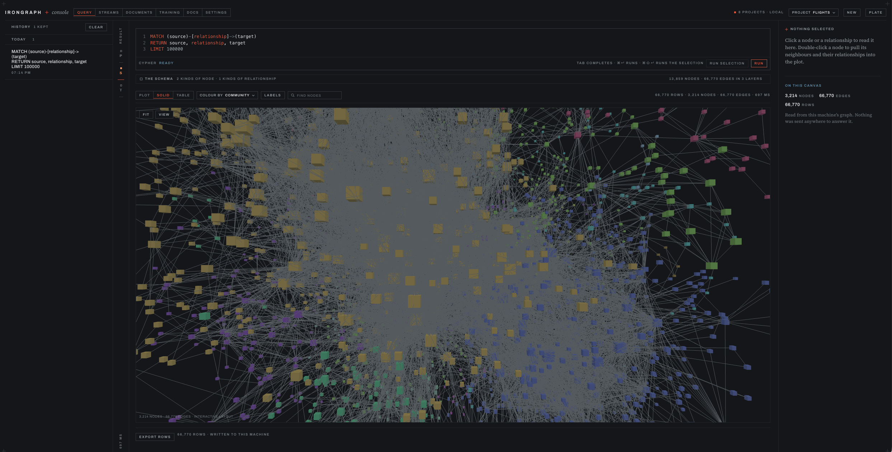

# IronGraph

**Embeddable Cypher graph database with sub-µs point reads, built-in streams, queues, and local text embeddings. Written in Rust.**

Embed IronGraph in **Python, Node.js, or Rust**, or run it as a standalone process. Query graphs,
search vectors, inspect property history, and administer topics and queues with Cypher.
Kafka and AMQP clients connect to the same database process. Local text embeddings run
asynchronously on CPU, Metal, or CUDA; graph execution runs on the CPU.

**[Quickstart](docs/getting-started.md) · [Documentation](docs/README.md) ·
[Cypher reference](docs/cypher/README.md) ·
[Releases](https://github.com/agentbusiness/IronGraph/releases)**



| Capability | Interface |
| --- | --- |
| Property graph and analytics | Cypher patterns, variable-length paths, PageRank, shortest paths, components, and communities |
| Text and vector retrieval | Automatic embeddings for nodes and relationships; semantic search composed with graph queries |
| Temporal properties | `AT TIME`, `HISTORY`, time windows, and maintained rollups |
| Streams | Kafka-compatible producers and consumers; topic, retention, and consumer-lag administration in Cypher |
| Queues | AMQP-compatible queues, exchanges, and bindings; classic and stream queues |

Projects isolate graphs and indexes. `OBSERVED`, `KNOWLEDGE`, and `WORKSPACE` distinguish source,
curated, and provisional data. Embedded and standalone deployments share transactions,
write-ahead logging, recovery, and snapshots. The standalone distribution includes a web console,
Bolt, an HTTP Query API, and local MCP over stdio or Streamable HTTP.

## Performance

**Submicrosecond node and relationship counts.** Recorded CPU benchmarks on an Apple M5 Pro
measured median counts of **0.792 µs** and **0.791 µs**, respectively, on a graph with
**100,000 nodes and 400,000 relationships**. These measure in-process query execution;
SDK decoding and network transport add latency.

## Install and run

The standalone npm launcher requires Node.js 20.17 or later and a matching published platform
package. Native release targets are macOS 15+ ARM64 and Linux ARM64/AMD64 with glibc 2.28+.

```sh
npx irongraph start --background --embedding-backend cpu
```

Check readiness with `npx irongraph status`, then open the local console at
[127.0.0.1:18484/web/](http://127.0.0.1:18484/web/). First startup downloads and prepares the
embedding model; allow network access and several gigabytes of free storage. Data persists
in `~/.irongraph/data`. Use `--embedding-backend metal` for Metal inference on a supported Mac.

Stop with `npx irongraph stop`. See [installation](docs/installation.md) for native archives,
source builds, directories, and listener configuration.

## Query a graph with Cypher

Create a project, then run each statement separately in Query:

```cypher
CREATE PROJECT recommendations
```

```cypher
USE recommendations
CREATE
  (ada:Developer {name: 'Ada', language: 'Rust'}),
  (lin:Developer {name: 'Lin', language: 'Python'}),
  (mira:Developer {name: 'Mira', language: 'TypeScript'}),
  (graph:Technology {name: 'Graph databases'}),
  (ada)-[:RECOMMENDS]->(graph),
  (lin)-[:FOLLOWS]->(ada),
  (mira)-[:FOLLOWS]->(lin)
```

Find recommendations through one or more `FOLLOWS` relationships:

```cypher
USE recommendations
MATCH (developer:Developer)-[:FOLLOWS*1..]->(:Developer)-[:RECOMMENDS]->(topic:Technology)
RETURN developer.name AS developer, topic.name AS recommendation
ORDER BY developer
```

| developer | recommendation |
| --- | --- |
| Lin | Graph databases |
| Mira | Graph databases |

The [quickstart](docs/getting-started.md) includes graph visualization and a Python example.
Every data query selects a project explicitly; there is no implicit default project.

## Streams and queues use Cypher too

In an existing project, create a Kafka-compatible topic:

```cypher
USE recommendations
CREATE TOPIC activity PARTITIONS 12 RETENTION 30 DAYS
```

Create an AMQP-compatible exchange and stream queue, then bind them. Run each statement separately:

```cypher
USE recommendations CREATE EXCHANGE routing TYPE TOPIC
```

```cypher
USE recommendations CREATE QUEUE updates STREAM RETENTION 14 DAYS
```

```cypher
USE recommendations BIND QUEUE updates TO EXCHANGE routing KEY updates
```

Producers and consumers use supported Kafka or AMQP clients. Cypher manages topics, queues,
exchanges, bindings, retention, and consumer lag. See [streams and queues](docs/features.md#kafka-compatible-streams).

## Search nodes and relationships by meaning

With local embeddings enabled and the automatic indexes `ONLINE`, search the same project:

```cypher
USE recommendations
SEARCH entity IN (EMBEDDING INDEX graph_semantic
                  FOR TEXT 'developers interested in graph databases' LIMIT 5)
  SCORE AS score
RETURN entity, score
```

Results include ranked nodes and relationships. Embeddings are maintained asynchronously as
content changes. Use [field-specific embedding indexes](docs/cypher/clauses/search/create-embedding-index.md)
to select a particular text property, or supply your own vectors.

## Choose your package

| Application | Package | Access |
| --- | --- | --- |
| Standalone database and web console | `irongraph` on npm, or native archive | Local process and remote listeners |
| [Python](bindings/python/README.md) | `irongraph` | Embedded and remote |
| [Node.js](bindings/node/README.md) | `@irongraph/node` | Embedded and remote |
| [Rust / Cargo](bindings/rust/README.md) | `irongraph-sdk` | Embedded and remote |
| [Browser / React](bindings/javascript/README.md) | `@irongraph/client`, with `/react` exports | Remote Query API |

Install from the official package source or artifact bundle supplied with your release. An
installation command requires the matching release to be available in that source. Native
release targets are macOS 15+ ARM64 and Linux with glibc 2.28+ on ARM64 or AMD64. These are the
package build baselines; deployment support depends on the qualification results supplied with
your release. CUDA text inference requires a package built with CUDA support.

## Start with a text document in Python

You need Python 3.9 or later, a matching official wheel, and a writable directory owned by one
application process. Default startup downloads, loads, and warms the local Bekko a8m embedding
model; allow network access and space for the model on first use.

After configuring your official package source, install the binary package:

```sh
python -m pip install --only-binary=:all: irongraph
```

Save the following as `example.py`:

```python
from irongraph import EmbeddedDatabase

with EmbeddedDatabase("./irongraph-data", device="cpu") as database:
    database.query("CREATE PROJECT IF NOT EXISTS notes")
    result = database.query(
        """USE notes
        MERGE (document:Document {id: $id})
        SET document.body = $body
        RETURN document.body AS body""",
        parameters={"id": "welcome", "body": "Graphs connect facts."},
    )
    print(result["rows"][0][0]["value"])
```

Run it from the directory containing the file:

```sh
python example.py
```

Expected output: `Graphs connect facts.` The text document persists in the selected directory. Run
the example again to update and read the same text document. Its meaningful content is embedded
automatically, together with other nodes and relationships. Next, use
[`SEARCH … RETURN`](docs/cypher/clauses/search/search.md) with `graph_semantic` for ranked retrieval.

The graph always uses the CPU. Automatic text embedding remains enabled; select
`embedding_device="metal"` on a supported Mac to accelerate text inference.

## Deploy deliberately

Each database process holds one canonical graph in host memory and independently selects one text
inference device. One embedded instance owns its directory exclusively. Keep it open for your application's lifetime
and close it during orderly shutdown.

The local embedding model processes text; IronGraph does not host or invoke generative language
models. Text documents use the same storage, transactions, and recovery as other graph data.

Plain listeners bind only to loopback. Remote Query API, Bolt, Kafka-compatible Streams, and
AMQP-compatible Queues require mutual TLS. Browser certificates are managed by the browser.
The web console provides Query with a Plot view, Streams, Documents, Training, Docs, and Settings.
Local MCP exposes the Query API through stdio or loopback HTTP.

## License

IronGraph is licensed under the Apache License 2.0. Third-party components and the embedding model
retain their own license terms.
